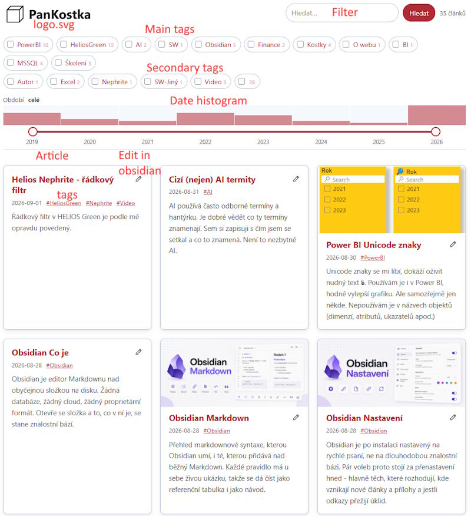

# obsidian2html - readme

> **Toto je zdroj, `README.md` je z něj odvozený překlad.** Změna se dělá tady a teprve pak se propíše do README. README se vymaže a pak vytvoří překladem z tohoto.  

## TODO
Poznámky pro mě co je třeba udělat
* Datum u článků by mělo jít nastavit na jiný formát než YYYY-MM-DD
* Hlavní a vedlejší menu předělat

## Co je obsidian2html

Toto je **generátor md->html**.  
**Python script**, který se zavolá na **vstupní adresář s md soubory** (typicky vault Obsidian, ale není to podmínkou) a on vytvoří do **výstupního adresáře html soubory**.  
Výstupní web běží samostatně, nepotřebuje databázi.  Jsou to **statické stránky s Javascriptem**.

Dva režimy publikování:
* **VŠE MIMO PODTRŽÍTKA a TEČKY** - publikuje se všechno kromě souborů a adresářů začínajících `_` nebo `.`.  
	Takže `_*.md` nebo `.*.md` se nepublikuje.  
	Cokoli v `_adresář\*.md`  nebo `.adresář\*.md` se taky nepublikuje. Tečka adresář v Obsidianu skryje a podtržítko ne.
* **JEN S MARKEREM** - Marker je znak 🌐, který musí být na konci názvu článku.  
	Takže se publikuje jen `*🌐.md`.  
	Pokud název začíná podtržítkem, např. `_Poznámka 🌐.md`, ignoruje se i s markerem (K20).

## Jak vypadá výsledek

Výsledný web zobrazuje perexy článků s náhledovým obrázkem. Dále se zobrazuje datum článku (ve formátu )
Kliknutím na článek se zobrazí detail článku.
Vlevo nahoře je logo, kliknutím na něj se zobrazí úvodní strana.
Vpravo nahoře je fulltextové filtrování článků a počet článků.
Nahoře je menu tvořené ze dvou částí. Hlavní menu a Vedlejší menu.
	* Hlavní menu - adresáře nebo tagy _
	* Vedlejší menu - všechny ostatní tagy mimo?




Tagy slouží jako filtr a lišta.  
Je možno filtrovat.  
S přepínačem `--edit-links` se u nadpisu článku zobrazí ikona tužky, která otevře zdrojovou poznámku v Obsidianu.  

## Instalace a spuštění

Vyžaduje nainstalovaný python 3.11 nebo novější a v něm doinstalovaný markdown (`pip install markdown`).  
Příklady volání (na pořadí přepínačů nezáleží) z příkazové řádky:

```
python md2html.py --source C:\vault --dest C:\web1 --publish "*🌐.md"
python md2html.py --source C:\vault --dest C:\web2 --publish "*.md"
```

## Co se jak převádí

- **Titulek** článku je název souboru bez markeru, takže `Obsidian Co je 🌐.md` má titulek `Obsidian Co je`.  
	Přebít ho jde klíčem `title` ve frontmatteru, třeba když je název souboru technický (K25).
- **Adresa** článku je název souboru bez markeru, bez diakritiky, malými písmeny a s pomlčkami, takže `Obsidian Co je 🌐.md` je `obsidian-co-je.html` (K30).
- **Datum** patří do frontmatteru jako `date: RRRR-MM-DD`, jinak se vezme datum souboru (K80).
- **Přílohy** se hledají nejprve vedle článku, pak ve složce pojmenované jako článek (název bez markeru stačí), pak v `Attachments/` a nakonec v celém vaultu (K50).
- **Hlavní tag** se označí podtržítkem, `_Obsidian`, a ve filtru na titulce pak vede (K97).

## Konfigurační soubory

Web se vygeneruje i bez dalších souborů, s nimi ale bude vypadat lépe.  
Žádný z nich není povinný.  
Patří do složky `.obsidian2html` nebo `_obsidian2html` ve vaultu. Tečka složku v Obsidianu skryje a podtržítko ne.

Soubory:
* `logo.svg` - logo webu. Změní logo webu vlevo nahoře na tento obrázek.
* `styl.css` - vlastní styl webu pro přepsání vzhledu - šířka, barvy, písmo apod.
* `menu.md` - určuje pořadí hlavních tagů, bez něj jsou abecedně.
* `index.md` - ruční úvod na titulce webu. Vykreslí se na úvodní stránce mezi filtrem a obsahem.
* `config.toml` - název, jazyk a adresa webu, filtr na období a hlavní tagy. Je to textový soubor ve formátu [TOML](https://toml.io):

```toml
name = "Pan Kostka"                 # název webu
lang = "cs"                         # jazyk webu, cs nebo en
base_url = "https://pankostka.cz"   # adresa webu, bez ní nevznikne rss.xml
date_filter = true                  # posuvník s histogramem na titulce
lead_tags = "folders"               # hlavní tag i z adresáře
```

## Pro vývoj

Podrobný popis je v [SPEC.cs.md](SPEC.cs.md).

## Licence

MIT - viz [LICENSE](LICENSE).
